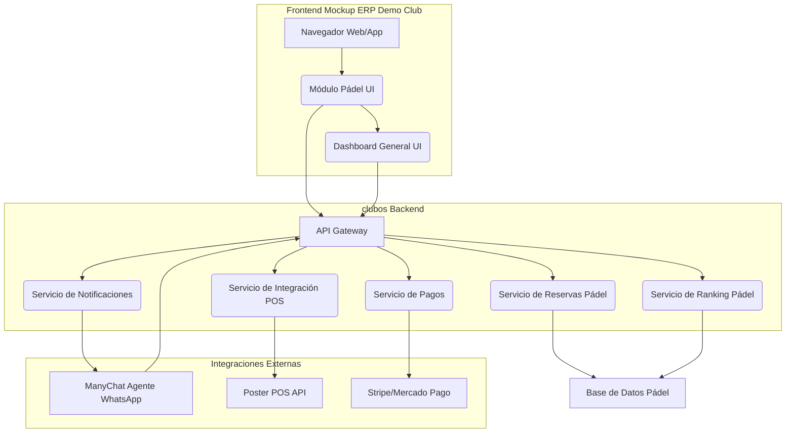

# Arquitectura de Integración: Módulo de Pádel clubos con Mockup ERP Demo Club

Este documento describe la arquitectura técnica para integrar el módulo de Pádel de clubos, incluyendo el Agente WhatsApp y el Motor de Reservas, con el frontend del mockup existente del ERP Demo Club (`playapalmas-maanqedb.manus.space`). El objetivo es transformar el mockup en una aplicación funcional y agéntica.

## 1. Visión General de la Arquitectura

La arquitectura propuesta sigue un modelo de **Backend for Frontend (BFF)** y **Microservicios**, donde el mockup actúa como el frontend y un nuevo conjunto de servicios de clubos provee la lógica de negocio y las integraciones.

## 2. Componentes Clave y su Interacción

### 2.1. Frontend (Mockup ERP Demo Club)

*   **Tecnología:** React/Vite. Se modificará para consumir datos de las APIs de clubos.
*   **Módulo Pádel UI:** Las vistas de disponibilidad de canchas, ranking, torneos y clases se conectarán a los servicios de clubos a través del API Gateway.
*   **Dashboard General UI:** Los widgets de métricas (Ingresos Pádel, Ocupación) se actualizarán con datos en tiempo real provenientes del backend de clubos, que a su vez los obtendrá del servicio de Pádel y del POS-Hub.
*   **Interacción con Agente WhatsApp:** El botón "Reservar" en el módulo de Pádel invocará el flujo del Agente WhatsApp (ManyChat) a través de un enlace profundo o una API.

### 2.2. clubos Backend

*   **API Gateway:** Punto de entrada unificado para todas las solicitudes del frontend y de integraciones externas (ManyChat). Se encargará de la autenticación, autorización y enrutamiento a los microservicios.
*   **Servicio de Reservas Pádel:**
    *   **Funcionalidad:** Gestión de disponibilidad de canchas, creación, modificación y cancelación de reservas.
    *   **Integración:** Expone APIs para el frontend y es invocado por el Agente WhatsApp.
    *   **Base de Datos:** Almacena la información de canchas, horarios y reservas.
*   **Servicio de Ranking Pádel:**
    *   **Funcionalidad:** Cálculo y actualización de puntos, gestión de partidos y torneos.
    *   **Integración:** Expone APIs para el frontend y recibe datos de resultados de partidos (posiblemente vía Agente WhatsApp o interfaz de administración).
*   **Servicio de Pagos:**
    *   **Funcionalidad:** Orquestación de transacciones con pasarelas de pago (Stripe, Mercado Pago).
    *   **Integración:** Invocado por el Servicio de Reservas y el POS-Hub para procesar cobros.
*   **Servicio de Notificaciones:**
    *   **Funcionalidad:** Envío de confirmaciones de reserva, recordatorios, alertas de torneos.
    *   **Integración:** Se conecta con ManyChat para enviar mensajes de WhatsApp.
*   **Servicio de Integración POS (POS-Hub):**
    *   **Funcionalidad:** Recibe webhooks de Poster POS, normaliza datos de ventas y los almacena.
    *   **Integración:** Expone APIs para que el Dashboard General consuma datos agregados de ventas.

### 2.3. Integraciones Externas

*   **ManyChat (Agente WhatsApp):** Actuará como la interfaz conversacional para los usuarios finales. Se configurarán flujos que interactúen con el API Gateway de clubos para realizar reservas, consultar rankings, etc.
*   **Poster POS API:** Se utilizarán sus APIs para la integración bidireccional, principalmente para recibir eventos de venta (webhooks) y, si es necesario, para realizar consultas específicas.
*   **Stripe/Mercado Pago:** Pasarelas de pago estándar para procesar transacciones de reservas y otros servicios.

## 3. Flujo de Usuario Ejemplo: Reserva de Cancha vía WhatsApp

1.  **Usuario Inicia Conversación:** El socio envía un mensaje al número de WhatsApp del club.
2.  **ManyChat Recibe Mensaje:** El Agente WhatsApp (ManyChat) identifica la intención de reservar.
3.  **ManyChat Consulta Disponibilidad:** ManyChat invoca una API del Servicio de Reservas de Pádel (vía API Gateway) para obtener horarios disponibles.
4.  **ManyChat Presenta Opciones:** El Agente muestra al usuario las opciones de cancha y horario.
5.  **Usuario Selecciona y Confirma:** El socio elige y confirma la reserva.
6.  **ManyChat Confirma Reserva:** ManyChat invoca otra API del Servicio de Reservas para crear la reserva y, si aplica, inicia el flujo de pago a través del Servicio de Pagos.
7.  **Notificación y Actualización:** El Servicio de Reservas actualiza la Base de Datos de Pádel y el Servicio de Notificaciones envía una confirmación al usuario. El Dashboard General del mockup se actualiza en tiempo real.

## 4. Beneficios de esta Estrategia

*   **Reutilización del Mockup:** Se aprovecha el diseño y la estructura existente, acelerando el desarrollo del frontend.
*   **Modularidad:** Permite el desarrollo y despliegue independiente de cada servicio, facilitando la escalabilidad y el mantenimiento.
*   **Experiencia Agéntica:** El Agente WhatsApp proporciona una interfaz de usuario intuitiva y accesible para las reservas.
*   **Datos en Tiempo Real:** El dashboard se convierte en una herramienta de monitoreo operativo dinámico.
*   **Preparación para Escalabilidad:** La arquitectura de microservicios sienta las bases para la futura expansión a otros módulos y condominios. [1] [2] [3] [4] [5] [6]
